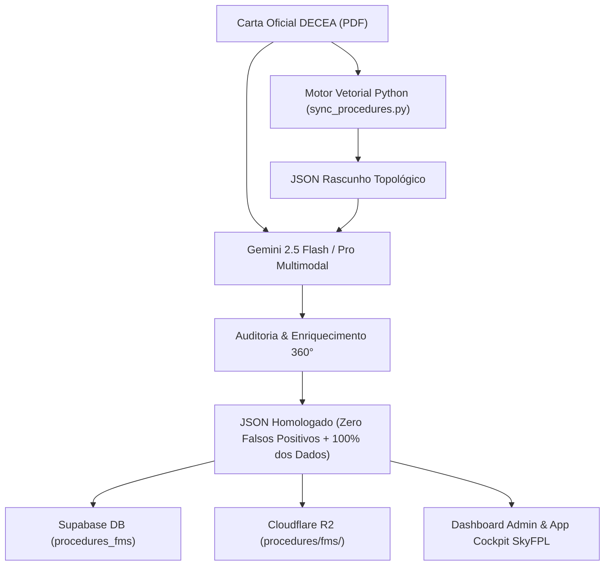

# Plano de Implementação: Auditoria & Extração 360° com Gemini Multimodal no Pipeline FMS

## 1. Visão Geral e Arquitetura

O objetivo é transformar o robô em nuvem do SkyFPL em um sistema híbrido de padrão aeroespacial:
1. **Pilot Flying (Motor Vetorial Python / PyMuPDF)**: Executa a geometria milimétrica, coordenadas euclidianas, arcos de curva, detecção de barras vetoriais e montagem da topologia da rota.
2. **Pilot Monitoring / Auditor Chefe (Gemini 2.5 Multimodal)**: Recebe o **PDF real de alta resolução** da carta DECEA e o rascunho de dados do Python. Faz a checagem cruzada visual, remove interferências de espaços aéreos condicionados (`SBP 225 1500 AMSL`), valida restrições e extrai todos os elementos visuais não tabulados (Notas RMK, Obstáculos Notáveis, Quadrículas AMA, Variação Magnética Anual).

---

## 2. Componentes a Serem Implementados

### Fase 1: Módulo Especialista de IA (`gemini_chart_auditor.py`)
Criar em `procedures-robot/gemini_chart_auditor.py`:
- Cliente `google-genai` com timeout seguro e controle de exceções.
- Prompt aeroespacial calibrado (ICAO Doc 8168 PANS-OPS / DECEA).
- Entrada: `pdf_bytes` (arquivo PDF real em bytes binários) + `procedure_draft_dict`.
- Schema de saída estruturado (`response_mime_type="application/json"`).
- Fallback determinístico: se a API estiver indisponível ou sem chave, retorna o rascunho matemático sem interromper o pipeline.

### Fase 2: Integração no Orquestrador (`sync_procedures.py`)
- Inserir a chamada `audit_and_enrich_chart_with_gemini()` em `process_single_chart()`.
- Execução em nível de carta (1 chamada única consolida todas as transições da folha, economizando até 80% de tokens e evitando *rate limits*).

### Fase 3: Dependências e Pipeline CI/CD (`requirements.txt` e GitHub Actions)
- Adicionar `google-genai>=0.1.0` em `procedures-robot/requirements.txt`.
- Adicionar `GEMINI_API_KEY: ${{ secrets.GEMINI_API_KEY }}` no arquivo `.github/workflows/process-fms-procedures.yml`.

### Fase 4: Enriquecimento das Colunas e Interface no Dashboard
- Salvar no Supabase `procedures_fms`:
  - `operational_remarks_json` (Notas RMK, restrições operacionais).
  - `notable_obstacles_json` (Obstáculos pontuais e cotas altimétricas no relevo).
  - `area_minimum_altitudes_json` (Quadrículas AMA).
- Exibir abas e badges complementares no Dashboard Admin para visualização desses dados enriquecidos.
